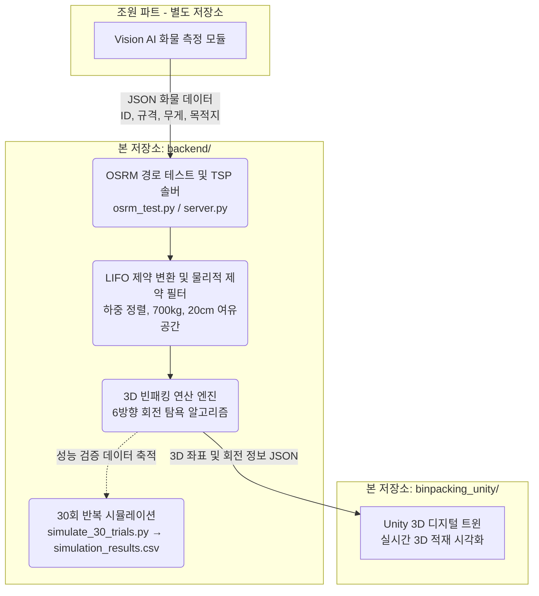

# 📦 Smart 3D Bin Packing & Route Optimization System

> Vision AI 기반 실시간 3D 빈패킹 및 라스트마일 경로 통합 최적화 시스템

[](https://www.python.org/)
[](https://fastapi.tiangolo.com/)
[](https://unity.com/)
[](http://project-osrm.org/)

---

## 📌 목차

1. [프로젝트 소개](#-프로젝트-소개)
2. [역할 분담 및 저장소 구성](#-역할-분담-및-저장소-구성)
3. [핵심 구현 기능](#-핵심-구현-기능)
4. [기술 스택](#-기술-스택)
5. [시스템 아키텍처](#-시스템-아키텍처)
6. [핵심 실험 결과](#-핵심-실험-결과)
7. [프로젝트 구조](#-프로젝트-구조)
8. [다운로드 및 실행 방법](#-다운로드-및-실행-방법)
9. [연계 모듈(조원 파트) 연동 안내](#-연계-모듈조원-파트-연동-안내)

---

## 📖 프로젝트 소개

이커머스 시장의 성장과 다품종 소량 배송의 증가로 라스트마일(Last-Mile) 물류의 효율화가 핵심 과제로 대두되고 있습니다. 그러나 실제 배송 현장에서는 지리적 최단 경로(TSP)와 트럭 내부 적재 순서가 일치하지 않아, 목적지마다 안쪽 화물을 꺼내기 위해 앞선 화물을 모두 빼내야 하는 하역 병목 현상(Unloading Bottleneck)이 발생합니다.

본 프로젝트는 실제 도로망 경로 탐색(OSRM) 기반의 TSP 최단 경로와 후입선출(LIFO) 3D 빈패킹 연산을 실시간으로 통합하고, 이를 Unity 3D 디지털 트윈으로 시각화하여 라스트마일 배송 소요 시간을 획기적으로 단축하는 시스템을 구현하였습니다.

 본 저장소의 핵심 범위: TSP-LIFO 통합 경로 및 3D 빈패킹 연산 백엔드(`backend/`), 30회 반복 성능 검증 시뮬레이션, Unity 3D 적재 시각화 클라이언트(`binpacking_unity/`)
 조원 담당 연계 모듈: 실행 환경과 기술 스택이 상이한 타 모듈(Vision AI 화물 치수 측정 등)은 별도 GitHub 저장소에서 독립 관리되며, 본 저장소와 Git Submodule(또는 API 인터페이스)로 연동됩니다.

---

## 👥 역할 분담 및 저장소 구성

| 담당 | 역할 및 주요 구현 내용 | 저장소 / 경로 |
| :--- | :--- | :--- |
| 박심원 ([@gisimon1018](https://github.com/gisimon1018)) | • OSRM 기반 TSP 최단 경로 탐색 및 LIFO 제약 변환<br>• 6방향 회전 허용 탐욕 3D 빈패킹 연산 엔진(`FastAPI`)<br>• 1톤 탑차 물리적 제약(가용 공간·하중·700kg 한도) 모델링<br>• 4단계 시나리오 30회 반복 시뮬레이션 및 통계 검증<br>• Unity 3D 실시간 적재 시각화 연동 | 본 저장소<br>(`backend/`, `binpacking_unity/`) |
| 김호 | • Vision AI 기반 화물 치수 측정 및 데이터 전처리<br>• (조원 담당 세부 기능 기입) | 🔗 [조원 GitHub 저장소 바로가기](https://github.com/kimho214694/binpacking) |

---

## ✨ 핵심 구현 기능

### 1. OSRM 연동 TSP-LIFO 통합 경로 및 3D 적재 연산 (`backend/server.py`)
 OSRM(Open Source Routing Machine)을 활용해 실제 도로망 기준의 목적지 간 주행 시간 및 최단 방문 경로(TSP)를 산출합니다.
 산출된 배송 순서의 역순(LIFO, 후입선출)을 3D 빈패킹의 절대적 제약 조건(Hard Constraint)으로 부여하여 하역 지연 페널티를 제거합니다.

$$T_{penalty} = 1 + 3n, \quad T_{total} = T_{drive} + \sum T_{penalty}$$

(단, $n$은 타겟 상자를 가로막는 방해 상자 개수)

### 2. 6방향 회전 허용 탐욕 알고리즘 (Greedy with Rotation)
 화물의 6가지 회전 방향(XYZ, XZY, YXZ, YZX, ZXY, ZYX)을 모두 탐색하여 데드 스페이스(Dead Space)를 최소화하면서도 LIFO 순서를 100% 보장합니다.

### 3. 실제 1톤 내장탑차 물리적 제약 조건 통제
 가용 적재 공간: 전체 길이 270cm 중 운행 시 쏠림 방지를 위한 문 쪽 20cm 안전 여유 공간을 제외한 $160(\text{W}) \times 200(\text{H}) \times 250(\text{L})\text{ cm}$ 적용
 최대 적재 중량 컷오프: 총중량 700kg 도달 시 추가 적재 자동 차단
 하중 안정성 정렬: 동일 목적지 내 무거운 화물을 트럭 바닥면(Y축 최하단)에 우선 배치하는 무게 내림차순 정렬 적용

### 4. 30회 반복 통계 시뮬레이션 (`backend/simulate_30_trials.py`)
 소형(30~55cm), 중형(50~80cm), 대형(70~110cm) 택배 규격 데이터셋을 기반으로 4단계 시나리오별 30회 반복 실험을 자동 수행하고 결과를 `simulation_results.csv`로 저장합니다.

### 5. Unity 3D 디지털 트윈 시각화 (`binpacking_unity/`)
 FastAPI 백엔드(`server.py`)로부터 JSON 형태의 3D 적재 좌표 $(X, Y, Z)$ 및 회전 상태를 실시간 수신하여, 탑차 안쪽부터 문 쪽으로 목적지별 색상으로 정렬된 적재 상태를 3D로 렌더링합니다.

---

## 🛠 기술 스택

| 구분 | 기술 스택 | 활용 내용 |
| :--- | :--- | :--- |
| Backend & API | Python 3.9+, FastAPI, Uvicorn | 실시간 TSP-LIFO 및 3D 빈패킹 연산 API 서버 (`server.py`) |
| Routing & Simulation | OSRM API, NumPy, Pandas, Requests | 도로망 기반 이동 시간 산출 (`osrm_test.py`) 및 30회 반복 검증 (`simulate_30_trials.py`) |
| 3D Visualization | Unity 3D (C#) | 1톤 탑차 디지털 트윈 및 실시간 적재 결과 렌더링 (`binpacking_unity/`) |
| Version Control | Git, GitHub (Submodule) | 파트별 독립 실행 환경 유지 및 저장소 연동 |

---

## 🏗 시스템 아키텍처



---

## 📊 핵심 실험 결과

`backend/simulate_30_trials.py`를 통해 4단계 시나리오별 각 30회 반복 측정을 수행한 결과(`simulation_results.csv`)는 다음과 같습니다.

| 단계 | 시나리오 구성 | 평균 총 소요 시간 ($T_{total}$) | 비고 |
| :---: | :--- | :---: | :--- |
| 1단계 | TSP 미적용 + LIFO 미적용 (무작위 배치) | 158.94초 | 기존 현장 기준선 (Baseline) |
| 2단계 | TSP 미적용 + LIFO 적용 | 129.41초 | 하역 지연 페널티 제거 |
| 3단계 | TSP 적용 + LIFO 미적용 | 90.44초 | 이동 동선만 최적화 |
| 4단계 | TSP 적용 + LIFO 적용 (제안 모델) | 60.71초 | 1단계 대비 약 61.8% 단축 |

 공간 활용도(Volume Utilization): 회전 허용 탐욕 알고리즘 적용 시 소·중·대형 혼재 시나리오 전반에서 평균 60% 이상의 안정적인 적재 효율을 유지하였습니다.

---

## 📂 프로젝트 구조

```text
smart-3d-bin-packing/
├── backend/                        # [Python] TSP-LIFO 경로 통합 & 3D 빈패킹 연산 서버
│   ├── server.py                   # FastAPI 메인 서버 및 3D 빈패킹·경로 통합 엔진
│   ├── osrm_test.py                # OSRM 도로망 경로/이동시간 산출 테스트 스크립트
│   ├── simulate_30_trials.py       # 4단계 시나리오 30회 반복 성능 검증 스크립트
│   ├── simulation_results.csv      # 30회 반복 시뮬레이션 결과 데이터
│   └── requirements.txt            # Python 패키지 의존성 목록
├── binpacking_unity/               # [Unity 3D] 디지털 트윈 적재 시각화 프로젝트
│   ├── Assets/                     # C# 스크립트, 3D 트럭/박스 모델, 씬(Scene)
│   ├── Packages/                   # Unity 패키지 매니페스트
│   └── ProjectSettings/            # Unity 프로젝트 설정
├── external-module/                # [Git Submodule] 조원 담당 모듈 연결 경로 (선택 사항)
├── .gitignore                      # venv, __pycache__, Unity Library/Temp/obj 등 제외
└── README.md                       # 프로젝트 안내 문서
```

---

## 🚀 다운로드 및 실행 방법

### 사전 요구 사항 (Prerequisites)
 Git
 Python 3.9 이상
 Unity Hub & Unity Editor (3D 시각화 실행 시)

### 1. 프로젝트 다운로드 (Clone)

터미널(PowerShell, CMD 또는 macOS/Linux Terminal)에서 저장소를 복제합니다.

```bash
# 기본 다운로드
git clone https://github.com/gisimon1018/smart-3d-bin-packing.git
cd smart-3d-bin-packing
```

### 2. 백엔드 가상환경 생성 및 패키지 설치 (`backend/`)

```bash
cd backend

# 1) 가상환경 생성
python -m venv venv
```

가상환경 활성화:
 Windows (PowerShell):
  ```powershell
  .\venv\Scripts\Activate
  ```
  (※ 스크립트 실행 권한 오류 발생 시 `Set-ExecutionPolicy -ExecutionPolicy RemoteSigned -Scope CurrentUser`를 먼저 실행하거나, CMD에서 `venv\Scripts\activate.bat`을 입력하세요.)
 macOS / Linux:
  ```bash
  source venv/bin/activate
  ```

의존성 패키지 설치:
```bash
pip install -r requirements.txt
```

### 3. FastAPI 연산 서버 실행

가상환경이 활성화된 상태에서 `backend/` 폴더 내 `server.py`를 구동합니다.

```bash
uvicorn server:app --reload
```

 서버가 실행되면 브라우저에서 `http://localhost:8000/docs`에 접속해 Swagger UI로 API를 직접 테스트할 수 있습니다.
 Unity 3D와 연동할 때는 이 터미널 창을 닫지 않고 유지하세요.

### 4. 경로 테스트 및 30회 반복 시뮬레이션 실행(김호)

새 터미널 창을 열어 `backend/` 가상환경을 활성화한 뒤 원하는 스크립트를 실행합니다.

```bash
# 1) OSRM 경로 탐색 API 연동 테스트
python osrm_test.py

# 2) 4단계 시나리오 30회 반복 성능 검증 실행 (결과는 simulation_results.csv에 저장)
python simulate_30_trials.py
```

### 5. Unity 3D 디지털 트윈 실행 (`binpacking_unity/`)

1. 3단계의 FastAPI 서버(`http://localhost:8000`)가 실행 중인지 확인합니다.
2. Unity Hub를 열고 `Add` → `Add project from disk`를 선택하여 클론한 저장소 안의 `binpacking_unity/` 폴더를 추가합니다.
3. 프로젝트를 열어 메인 씬(`Assets/Scenes/...`)을 로드합니다. (※ 최초 열기 시 제외되었던 `Library` 폴더가 자동 생성되므로 몇 분 소요될 수 있습니다.)
4. 에디터 상단의 Play(▶) 버튼을 누르면 백엔드 서버로부터 적재 좌표를 수신해 3D 트럭 내부 적재 결과가 렌더링됩니다.

---

## 🔗 연계 모듈(김호 파트) 연동 안내

조원이 담당한 모듈은 독립된 실행 환경으로 구성되어 있으며, 아래 명령어로 본 저장소에 서브모듈로 연결하거나 별도 저장소에서 내려받아 실행할 수 있습니다.

```bash
# (저장소 관리자가 최초 1회 조원 저장소를 서브모듈로 추가할 때)
git submodule add https://github.com/kimho214694/binpacking.git external-module
git commit -m "Add teammate module as git submodule"
git push origin main
```

 이미 복제한 저장소에서 서브모듈을 최신 상태로 내려받으려면 최상위 폴더에서 아래 명령어를 실행합니다.
  ```bash
  git submodule update --init --recursive
  ```

---

## 👤 Author

 GitHub: [@gisimon1018](https://github.com/gisimon1018)
