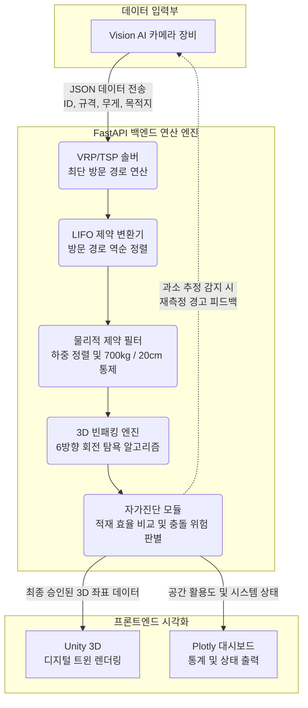

[smart_3d_bin_packing_readme.md](https://github.com/user-attachments/files/35238534/smart_3d_bin_packing_readme.md)
# 📦 Smart 3D Bin Packing & Route Optimization System
> **Vision AI 기반 실시간 3D 빈패킹 및 라스트마일 경로 통합 최적화 시스템**


---

## 📌 목차
1. [프로젝트 소개](#-프로젝트-소개)
2. [주요 기능](#-주요-기능)
3. [기술 스택](#-기술-스택)
4. [시스템 아키텍처](#-시스템-아키텍처)
5. [핵심 실험 결과](#-핵심-실험-결과)
6. [프로젝트 구조](#-프로젝트-구조)
7. [다운로드 및 실행 방법](#-다운로드-및-실행-방법)
8. [시각화 및 실행 화면](#-시각화-및-실행-화면)

---

## 📖 프로젝트 소개

이커머스 시장의 성장과 다품종 소량 배송의 증가로 라스트마일(Last-Mile) 물류의 중요성이 커지고 있습니다. 그러나 실제 배송 현장에서는 **지리적 최단 경로(TSP)**와 **트럭 내부 적재 순서**가 일치하지 않아, 목적지마다 안쪽 상자를 꺼내기 위해 앞선 화물을 모두 빼내야 하는 **하역 병목 현상(Unloading Bottleneck)**이 발생합니다.

또한 기존 물류 자동화 연구들은 정제된 데이터만을 가정하는 단방향성 모델에 머물러 있어, 실제 현장에서 발생하는 **Vision AI 스캐너의 측정 오차(특히 과소 추정)**로 인한 물리적 충돌 및 적재 불능 상황에 취약합니다.

본 프로젝트는 이를 해결하기 위해 다음 세 가지 핵심 기술을 통합 구현하였습니다.
- **TSP-LIFO 통합 최적화:** 배송 최단 경로의 역순(후입선출, LIFO)을 3D 빈패킹의 절대적 제약 조건으로 부여하여 하역 지연 페널티 제거
- **회전 허용 탐욕 알고리즘(Greedy with Rotation):** 화물의 6방향 회전을 모두 탐색하여 LIFO 규칙을 100% 유지하면서 60% 이상의 공간 활용도 확보
- **자기 치유형(Self-Healing) 자가진단 피드백 루프:** 몬테카를로 시뮬레이션(0~10cm 노이즈) 기반 민감도 분석을 통해 과소 추정에 의한 데이터 기만 현상을 실시간 탐지하고 재측정 경고 발송

---

## ✨ 주요 기능

### 1. TSP-LIFO 통합 경로 및 3D 적재 연산
- 목적지 방문 최단 경로(TSP)를 산출하고, 그 역순을 3D 빈패킹의 후입선출(LIFO) 규칙으로 강제합니다.
- 타겟 상자를 가로막는 방해 상자 개수($n$)에 따른 하역 지연 페널티를 수학적으로 모델링하여 총 배송 시간을 최소화합니다.

$$T_{penalty} = 1 + 3n, \quad T_{total} = T_{drive} + \sum T_{penalty}$$

### 2. 6방향 회전 허용 탐욕 알고리즘 (Greedy with Rotation)
- 무작위 배치(Random), 부피 내림차순(FFD), 기본 탐욕(Basic Greedy) 알고리즘의 한계를 비교 검증하고, 화물의 **6방향 회전(XYZ, XZY, YXZ, YZX, ZXY, ZYX)**을 모두 탐색하는 알고리즘을 최종 채택했습니다.
- 소형/중형/대형 화물이 혼재된 환경에서도 데드 스페이스(Dead Space)를 최소화합니다.

### 3. 실제 1톤 내장탑차 물리적 제약 조건 반영
- **가용 적재 규격:** 전체 길이 270cm 중 화물 쏠림 방지를 위한 문 쪽 20cm 안전 여유 공간을 제외한 $160(\text{W}) \times 200(\text{H}) \times 250(\text{L})\text{ cm}$ 적용
- **중량 컷오프(Cut-off):** 최대 적재 중량 700kg 초과 시 추가 적재 자동 차단
- **하중 안정성 정렬:** 동일 목적지 내 무거운 화물을 바닥면(Y축 최하단)에 우선 배치하는 내림차순 정렬 적용

### 4. Vision AI 측정 오차 민감도 분석 및 자가진단(Self-Healing)
- 몬테카를로 시뮬레이션으로 화물 치수에 0~10cm의 난수 노이즈를 주입하여 오차 방향성(**과대 추정 `+`** vs **과소 추정 `-`**)의 영향을 분석합니다.
- 실제보다 작게 인식된 과소 추정으로 인해 수치상 적재 효율이 비정상적으로 급증할 경우, 이를 성능 향상이 아닌 **물리적 충돌 위험**으로 판별하여 배치를 중단하고 재측정 피드백을 전송합니다.

### 5. 디지털 트윈 3D 시각화 및 관제 대시보드
- **Unity 3D:** 탑차 내부 Z축 안쪽부터 문 쪽으로 목적지별 색상으로 정렬된 3D 적재 결과 렌더링
- **Plotly:** 마우스 오버(Hover)로 각 화물 ID, 규격, 무게, 목적지를 확인할 수 있는 인터랙티브 3D 시각화 및 통계 차트 제공

---

## 🛠 기술 스택

| 구분 | 기술 스택 | 활용 내용 |
| :--- | :--- | :--- |
| **Backend & API** | Python 3.9+, FastAPI, Uvicorn | 비동기 실시간 TSP-LIFO 및 3D 빈패킹 연산 API 서버 |
| **Algorithm & Data** | NumPy, Pandas | 6방향 회전 탐욕 알고리즘, 몬테카를로 노이즈 시뮬레이션 및 통계 검증 |
| **Visualization** | Unity 3D (C#), Plotly | 디지털 트윈 3D 적재 렌더링 및 인터랙티브 분석 대시보드 |
| **Environment** | Git / GitHub, Virtualenv (`venv`) | 버전 관리 및 실행 환경 격리 |

---

## 🏗 시스템 아키텍처



---

## 📊 핵심 실험 결과

### 1. 4단계 시나리오별 배송 소요 시간 비교 (각 30회 반복 측정)
| 단계 | 시나리오 구성 | 평균 총 소요 시간 ($T_{total}$) | 비고 |
| :---: | :--- | :---: | :--- |
| **1단계** | TSP 미적용 + LIFO 미적용 (무작위 배치) | 158.94초 | 기존 현장 기준선 (Baseline) |
| **2단계** | TSP 미적용 + LIFO 적용 | 129.41초 | 하역 지연 페널티 제거 |
| **3단계** | TSP 적용 + LIFO 미적용 | 90.44초 | 이동 동선만 최적화 |
| **4단계** | **TSP 적용 + LIFO 적용 (제안 모델)** | **60.71초** | **1단계 대비 약 61.8% 단축** |

### 2. 적재 알고리즘 공간 활용도(Volume Utilization) 비교
- **회전 허용 탐욕 알고리즘(최종 채택):** 소형(80개), 중형(45개), 대형(18개) 화물 시나리오 전반에서 **평균 60% 이상**의 체적 활용률과 가장 낮은 표준편차(안정성) 기록
- **FFD / 기본 탐욕 알고리즘:** 대형 화물 유입 시 효율이 40%대로 하락하거나 LIFO 배송 순서가 파괴되는 한계 확인

### 3. Vision AI 측정 오차 자가진단 임계치
| 판정 상태 | 추정 오차 범위 | 시스템 대응 동작 |
| :---: | :--- | :--- |
| 🟢 **양호 (Normal)** | 1cm 이하 | 정상 적재 플랜 승인 및 시각화 출력 |
| 🟡 **주의 (Warning)** | 1cm ~ 3cm | 관제 대시보드에 주의 및 재측정 권장 알림 표출 |
| 🔴 **위험 (Critical)** | 3cm 초과 또는 기준 효율 대비 $\pm 3.0\%\text{p}$ 이상 급증 | 과소 추정 충돌 위험 진단, 배치 중단 및 카메라 재측정 명령 전송 |

---

## 📂 프로젝트 구조

```text
smart-3d-bin-packing/
├── backend/                          # FastAPI 서버 및 핵심 최적화 알고리즘
│   ├── main.py                       # FastAPI 엔트리포인트 및 API 라우터
│   ├── algorithm_comparison.py       # 적재 알고리즘 4종 비교 실험 스크립트
│   ├── error_efficiency_experiment.py # 0~10cm 몬테카를로 오차 민감도 분석
│   ├── self_diagnostic.py            # 자가진단 피드백 루프 테스트 스크립트
│   └── requirements.txt              # Python 의존성 패키지 목록
├── unity/                            # Unity 3D 디지털 트윈 프로젝트
│   ├── Assets/                       # C# 스크립트, 3D 모델, 씬(Scene) 파일
│   ├── Packages/                     # Unity 패키지 매니페스트
│   └── ProjectSettings/              # Unity 프로젝트 설정
├── docs/                             # README용 시뮬레이션 캡처 및 그래프 이미지
├── .gitignore                        # venv, Unity Library/Temp 등 제외 설정
└── README.md                         # 프로젝트 문서
```
> ※ 실제 폴더나 파일명이 일부 다른 경우, 현재 저장소 구조에 맞게 파일명을 수정하여 사용해 주세요.

---

## 🚀 다운로드 및 실행 방법

### 사전 요구 사항 (Prerequisites)
- **Git** 설치
- **Python 3.9 이상** 설치
- **Unity Hub & Unity Editor** 설치 (3D 디지털 트윈 실행 시)

---

### 1. 프로젝트 다운로드 (Clone)
터미널(PowerShell, CMD, 또는 macOS/Linux Terminal)을 열고 저장소를 복제합니다.

```bash
git clone https://github.com/gisimon1018/smart-3d-bin-packing.git
cd smart-3d-bin-packing
```

---

### 2. Python 가상환경 생성 및 패키지 설치
`backend` 폴더로 이동하여 가상환경을 생성하고 필요한 라이브러리를 설치합니다.

```bash
cd backend

# 1) 가상환경 생성
python -m venv venv
```

**가상환경 활성화:**
- **Windows (PowerShell):**
  ```powershell
  .\venv\Scripts\Activate.ps1
  ```
  *(※ PowerShell 스크립트 실행 권한 오류가 발생하면 `Set-ExecutionPolicy -ExecutionPolicy RemoteSigned -Scope CurrentUser`를 먼저 입력하거나 CMD에서 `venv\Scripts\activate.bat`을 실행하세요.)*
- **macOS / Linux:**
  ```bash
  source venv/bin/activate
  ```

**라이브러리 설치:**
```bash
# requirements.txt가 있는 경우
pip install -r requirements.txt

# 또는 직접 설치하는 경우
pip install fastapi uvicorn numpy pandas plotly requests
```

---

### 3. FastAPI 백엔드 서버 실행
가상환경이 활성화된 상태에서 아래 명령어로 백엔드 API 서버를 실행합니다.

```bash
uvicorn main:app --reload
```
- 서버가 정상 실행되면 브라우저에서 `http://localhost:8000/docs`에 접속하여 Swagger UI로 API 동작을 테스트할 수 있습니다.
- **Unity 3D 또는 클라이언트와 연동할 때는 이 터미널 창을 닫지 않고 유지하세요.**

---

### 4. 알고리즘 비교 및 오차 민감도 실험 실행
**새 터미널 창**을 열어 가상환경을 다시 활성화한 뒤, 실행하고자 하는 실험 스크립트를 구동합니다.

```bash
# 1) 적재 알고리즘 4종 (Random, FFD, Basic Greedy, Greedy with Rotation) 성능 비교
python algorithm_comparison.py

# 2) Vision AI 측정 오차(0~10cm) 민감도 분석 및 그래프 출력
python error_efficiency_experiment.py

# 3) 자가진단 피드백 루프(과소 추정 탐지) 테스트
python self_diagnostic.py
```
- 실행이 완료되면 터미널에 통계 결과가 출력되며, Plotly 인터랙티브 3D 시각화 및 그래프가 웹 브라우저에 자동으로 열립니다.

---

### 5. Unity 3D 디지털 트윈 실행
1. 3단계의 **FastAPI 백엔드 서버(`http://localhost:8000`)가 실행 중**인지 확인합니다.
2. **Unity Hub**를 실행한 뒤 `Add` -> `Add project from disk`를 클릭하여 클론한 폴더 내의 `unity/` 폴더를 선택합니다.
3. 프로젝트가 열리면 메인 씬(`Assets/Scenes/...`)을 불러옵니다. *(※ 최초 실행 시 `Library` 폴더가 자동 생성되므로 로딩에 수 분이 소요될 수 있습니다.)*
4. Unity 에디터 상단의 **Play(▶)** 버튼을 누르면 백엔드로부터 적재 좌표를 수신하여 1톤 탑차 내부 3D 적재 결과가 실시간으로 렌더링됩니다.

---

## 🖼 시각화 및 실행 화면

> 아래 이미지는 `docs/` 폴더에 실제 결과 캡처 파일을 넣은 뒤 파일명을 맞춰 연결하면 GitHub에 자동으로 표시됩니다.

| Unity 3D 디지털 트윈 적재 결과 | 4단계 시나리오 및 오차 민감도 분석 그래프 |
| :---: | :---: |
|  |  |
| *목적지 역순(LIFO) 기반 3D 빈패킹 렌더링* | *과대/과소 추정 오차에 따른 효율 변동 분석* |

---

## 👤 Author
- **GitHub:** [@gisimon1018](https://github.com/gisimon1018)
